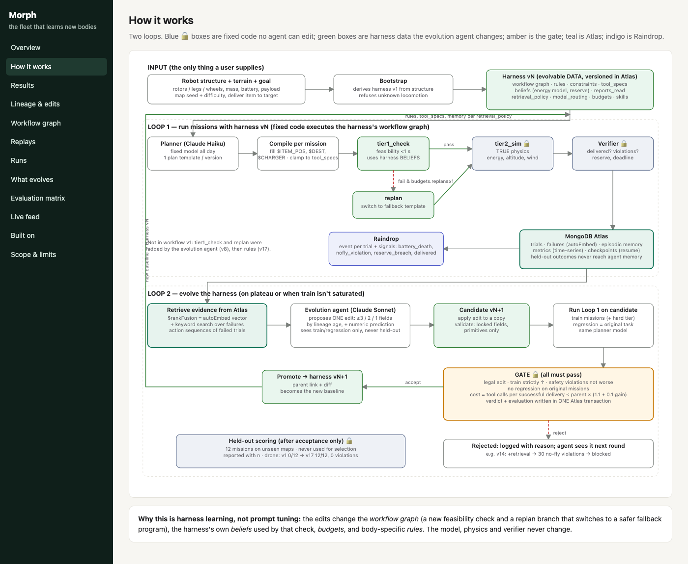
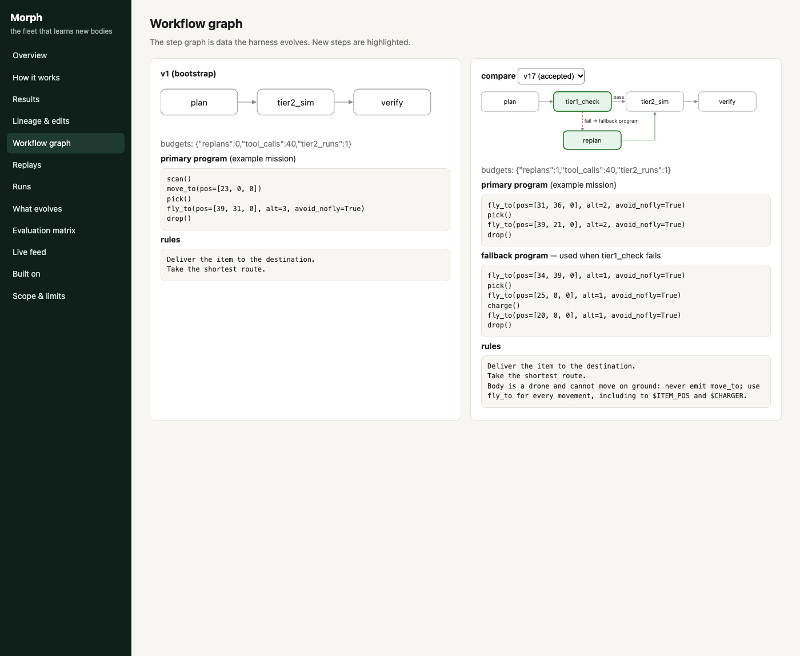

# Morph — the fleet that learns new bodies

**Plug in a robot. The harness does the rest.**

Robot fleets are mixed and keep changing: bodies get damaged, refitted with new payloads, or replaced by
another vendor's model. Today every change means engineers rewrite rules, limits and routing by hand, then
re-test — weeks per body. Morph is a self-evolving **harness** around a fixed planner model. It reads a new
body's structure, guesses what it can do, learns from its own failures, and keeps only changes that are
proven on missions it never saw. Every lesson is stored in MongoDB Atlas and can transfer to the next body.

**The model never changes. The harness does.**

Built solo at The Harness Engineering & Model Wrangling #SFTechWeek Hackathon (Oct 11 2026).
Problem statement: **1 — Recursive Harnessing** (primary); touches **2 — Long Horizon** through
persistent Atlas memory and checkpoint/resume.

---

## How it works



Workflow graph v1 vs v17: the evolution agent added a feasibility check and a replan branch (v8) and a body
rule (v17). The v1 drone program used `move_to` (a ground move); v17 flies every leg and charges after pickup.



```
 user supplies: robot structure + terrain + goal          (never rules, tools or code)
        │
        ▼
 bootstrap harness v1 from structure ──► harnesses (Atlas, versioned, parent links)
        │
        ▼   Loop 1: missions                         Loop 2: evolution (on plateau)
 planner (fixed free model) writes a plan template    evolution agent reads failures
        │                                             ($rankFusion: autoEmbed vector + keyword)
 workflow graph from the harness:                     proposes ONE bounded edit + prediction
   plan → tier1_check → replan → tier2_sim → verify          │
        │                                             candidate evaluated on train + regression
 locked verifier scores against TRUE physics                 │
        │                                             gate: legal, train ↑, safety not worse,
 trials, failures, episodic memory → Atlas            no regression, cost per success
 one event per trial + failure signals → Raindrop     verdict + evaluation in one transaction
```

**Fixed code (no agent edits it):** `sim/` world, physics, skills, tier 1/2, verifier, renderer;
`engine/runner.py`, `engine/gate.py`.

**Evolvable data (the harness document):** workflow graph, rules, constraints, tool specs, beliefs
(energy model, reserve), reports read, retrieval policy, model routing, budgets, composed skills.
Locked: `constraints.nofly` and `constraints.collision` stay `hard`; tools must be primitives.

## Results (drone, same planner model for every row)

**Held-out drone missions: 0/12 → 12/12, 0 safety violations, same planner model (Claude Haiku).**

Planner: Claude Haiku via Claude Code headless (`claude -p`), fixed for every row below.
Evolution agent: Claude Sonnet via `claude -p`. Physics: v2 (no-fly ceiling at z=6, wind drain grows with altitude).

| Version | Edit (by the evolution agent) | Train | Regression | Held-out | Violations | Gate |
|---|---|---|---|---|---|---|
| v1 | bootstrap from structure | 0/6 | 1/4 | **0/12** | 0 | — |
| v8 | +tier1_check, +replan, energy belief 0.75, reserve 10% | 0/6 | 2/4 | 0/12 | 0 | accepted earlier |
| v15 | rule: drone never uses ground moves | 2/6 | 3/4 | — | 3 | **rejected**: safety worse |
| v16 | rule: shortest route avoiding no-fly | 2/6 | 1/4 | — | 2 | **rejected**: safety worse, regression |
| **v17** | rule: drone cannot move on ground; use fly_to for every leg incl. charger | **5/6** | 2/4 | **12/12** | **0** | **accepted** |
| v14 (earlier) | planner reads 2 past episodes | 2/6 | 1/4 | — | 30 | **rejected**: safety worse |

The v1 harness failed because the planner, given only the body structure, emitted ground moves for a drone.
The evolution agent read the action sequences of failed trials, wrote a body-specific rule, and the gate
promoted it only after train improved with no new violations and no regression. Held-out missions were
scored after acceptance and never used for selection.

Earlier runs (free Nemotron planner, physics v1) are kept in Atlas for comparison: v1 1/6 → v8 2/6 train.

### Hard tier and transfer

- **Hard tier** (long-range loaded drone missions where a direct flight fails and only charge-after-pickup
  works): v17, never evolved on these, scores train 5/6 (n=6) and held-out **4/6** (n=6). Three further edits
  were all rejected by the gate for adding violations — including one that turned off no-fly avoidance (v19).
- **Transfer:** quadruped and held-out hexapod score **12/12 held-out (n=12) from bootstrap** on medium
  single-delivery missions: generations to adapt = 0 for ground bodies vs 1 accepted edit for the drone.
  Cold vs warm (taxonomic) transfer is implemented (`engine/transfer.py`) but **not measured**: there was no
  gap to close on that cell. Harder legged cells (hard/deadline: 3/6) are next.

## Evaluation matrix

| Axis | Values |
|---|---|
| Bodies | rover, tracked, quadruped, drone, rail cart, **hexapod (held-out body)** |
| Dimensions | 1D corridor (rail), 2D city (ground), 3D voxel city (drone) |
| Terrain difficulty | easy (open, many chargers), medium (rubble), hard (more rubble, 2 chargers, 1 river ford, big no-fly) |
| Mission types | single delivery, heavy payload, deadline-tight, multi-stop, relay (two bodies, handoff) |

90 cells × (train 6 / regression 4 / held-out 12) missions, generated from seeds in 3.5 s, each checked
solvable under the true physics. Splits use disjoint seed ranges; held-out outcomes never reach
agent-readable memory. Rail cart multi-stop and relay cells are short (a single track has too few distinct points).

Target numbers for the pitch: held-out success per body; **generations to adapt per body, falling as
lessons transfer**; safety violations on promoted versions.

## Scope and limitations

What Morph claims, narrowly: for **high-level mission planning** of robots built from a known movement
vocabulary (wheels, legs, rotors, tracks, rail) on a known grid map, Morph adapts the harness to a new body
without retraining, and never promotes a change that adds safety violations **on the tested missions**.

- **Planning layer only.** Morph decides where to go, when to charge, what to carry. It does not control
  motors, balance or gaits; it assumes each body has a working low-level controller.
- **Known movement vocabulary.** Bootstrap refuses a body whose locomotion is outside
  `{wheels, legs, rotors, tracks, rail}` and says why, instead of guessing.
- **Simplified simulated physics.** Energy, speed and terrain costs are models. No sim-to-real claim.
- **Static, known maps.** No moving obstacles, people or sensor noise.
- **Measured only on what we tested.** Every score is reported with its n (e.g. held-out 12/12, n=12, one
  body). "No new violations" holds on those missions; it is not a safety guarantee.
- **Fixed planner model.** Results are for Claude Haiku as planner; another model needs re-evaluation.
- **Single robot per mission.** Fleet relay is generated in the matrix but not planned for yet.
- **Charger choice is fixed code.** The mission compiler always picks the charger nearest the route, so the
  harness cannot learn charger selection (the remaining hard-tier failures). Candidate for a tier-2 expansion.
- **Memory retrieval hurt twice.** Letting the planner read past episodes (v14, v20) added no-fly violations;
  the gate rejected both.
- **Locked safety switches.** v19 tried to turn off no-fly avoidance; the gate rejected it on safety, and the
  legality check now blocks that edit before any run.

### How the harness may expand (tiered by risk)

| Tier | What the harness may add | Approval | Status today |
|---|---|---|---|
| 1. Automatic | rules, constraints, budgets, retrieval policy, workflow steps, reports, composed skills from primitives, corrected beliefs | the gate alone | **built** |
| 2. Sandboxed | new capability as code (skill function, report generator, mode plugin for an unseen locomotion), tested in sim | gate + stricter suite, held as candidate | next |
| 3. Human ask | anything that expands authority: new zone type allowed, limit above spec, new primitive for a body, loosened constraint | stored ask, human approves once, decision remembered | next |

Locked forever: the verifier, the true physics, scoring and held-out data. **The harness can expand what it
does, never how it is judged.**

## MongoDB Atlas features used

| Feature | Job in Morph |
|---|---|
| Versioned documents, unique `(body_type, version)` index | harness lineage v1 → v2 → … with parent links and diffs |
| **Multi-document transaction** | harness verdict + evaluation record written atomically |
| **Automated embeddings (autoEmbed, voyage-4-lite)** | failure summaries and four memory types embedded by Atlas on insert |
| **Vector Search + Atlas Search + `$rankFusion`** | hybrid retrieval of similar past failures for the evolution agent |
| Time-series collection | per-trial metrics for curves |
| Checkpoints collection | runner state per workflow node; a killed run resumes |
| Memory collections (semantic / episodic / procedural / taxonomic) | Agent Engine–shaped memory; user_id = body category |
| LLM response cache (unique key) | deterministic re-runs within the free-model budget |
| **Change streams** | live feed in the evidence viewer (`viewer/server.py`): trials, new versions, gate decisions |

Atlas Agent Engine: CLI signed in and a memory-only project scaffolded; the memory server needs a Voyage
key and was not provisioned today, so memory runs on plain collections with the same API shape.

## Built today vs used

**Built today:** everything in `sim/`, `engine/`, `scripts/` — the N-D world, physics, skills, tiers,
verifier, renderer, mission matrix, harness schema, planner, runner, evolution agent, gate, memory,
telemetry, reports.

**Used:** MongoDB Atlas (sandbox cluster), Claude Haiku (planner) and Claude Sonnet (evolution agent) via Claude Code
headless mode (`claude -p`), OpenRouter free models (earlier runs), Raindrop (Python SDK), numpy, matplotlib, ffmpeg, pymongo.
Not used: MuJoCo, real robots, any training or fine-tuning.

## Evidence viewer (localhost)

`PYTHONPATH=. uv run python viewer/server.py` → http://localhost:8765 — read-only on Atlas. Sidebar: overview,
results (k/n per split), lineage and diffs with gate checks and retrieved failures, workflow graph v1 vs vN,
side-by-side replays, runs, what evolves, evaluation matrix, live change-stream feed, built on, scope.

## Run it

```bash
uv sync
cp .env.example .env   # MONGODB_URI, OPENROUTER_API_KEY, RAINDROP_WRITE_KEY
PYTHONPATH=. uv run python -c "from engine.store import ensure_schema; ensure_schema()"
PYTHONPATH=. uv run python -m engine.loop drone --gens 4        # evolve
PYTHONPATH=. uv run python scripts/replay.py drone train-drone-105 1 8   # MP4 replays in out/
PYTHONPATH=. uv run python scripts/matrix_report.py              # matrix status
```

## Honesty notes

- Physics is simulated and simple (grid cells, Wh per cell, quadratic flight payload cost).
- Held-out sets are small (12 missions per cell); results above are train/regression only so far.
- Free models cap at 50 requests/day; one plan template per harness version keeps evaluation cheap and
  deterministic, at the cost of per-mission LLM reasoning.
- The evolution agent sees train/regression failures only, never held-out missions or the verifier.

## Prior art and how Morph differs

Self-improving harness work (GEPA, Self-Harness, Darwin Gödel Machine, RRSI) evolves prompts or agent code
on fixed tasks; RRSI shows unregularized harness evolution often fails to transfer. Morph keeps the model
fixed, evolves only harness data, gates on regression with a locked verifier, and targets a different
shift: **a new robot body**, measured by how fast the harness adapts.

## Real robots each body stands in for

rover — Clearpath Husky/Jackal · tracked — FLIR PackBot, Telerob tEODor · quadruped — Boston Dynamics Spot,
ANYbotics ANYmal, Unitree B2 · drone — DJI Matrice 350, Skydio X10 · rail cart — rail-guided inspection
robots in tunnels, mines, data centers · hexapod — research platforms.

Next: multi-floor buildings (stairs as 3D for legged bodies), relay planning, quadruped/hexapod transfer runs.
